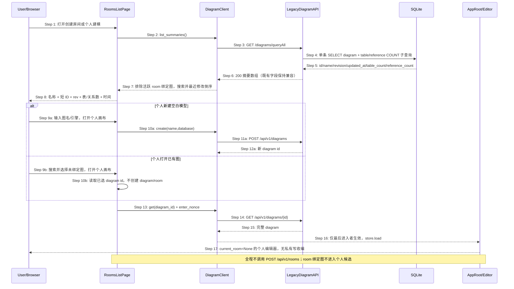

## ADDED — 3A. 时序图 — 图表候选与个人建模（feat-room-diagram-picker / #56）

- 创建协作房间继续走 §3 既有 `POST /api/v1/rooms` 时序；图表选择器只替换候选呈现，不改变房间创建合同。
- 危险删除仍走既有 `DELETE /api/v1/diagrams/{id}` + 二次确认，确认上下文增加完整 ID 与规模信息。
- 新增响应字段仅用于显示与搜索；无 DB migration、无新增 API 端点、无逐图补充查询。
