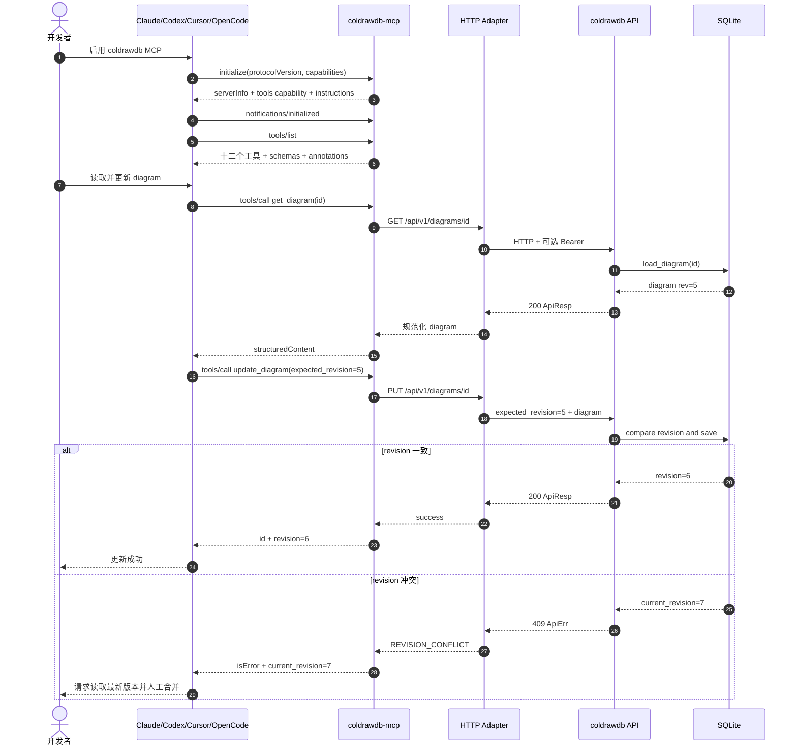
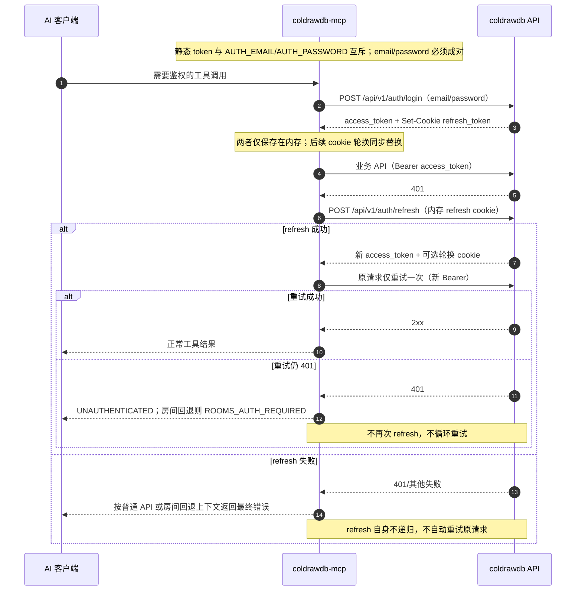

# S06 时序图：AI 客户端通过 MCP 管理数据库图表 — Delta

> 提案：fix-issues-70-73 | 关联 issue：#70、#71、#72
> 合并规则：以下 `ADDED` 章节插入主文档对应位置；`MODIFIED` 章节完整替换主文档同号章节；未列章节保持不变。新增时序位于 §6 API 推导之前。

## MODIFIED — §3 主时序：初始化、读取与更新



成功标志中的工具发现数量为 12；其余 revision 与人工合并语义不变。

## ADDED — §5.1 辅时序：整表与关系数组无损分片（fix-issues-70-73 / #70）

```mermaid
sequenceDiagram
  autonumber
  participant C as AI 客户端
  participant M as coldrawdb-mcp
  participant A as coldrawdb API
  participant W as 房间 WebSocket

  Note over C,M: 单表一片；关系按数组分片；单次参数建议约 48 KiB
  loop 每张表严格串行
    C->>M: update_table(action=create, table_id+表属性+fields)
    M->>A: GET /api/v1/diagrams/{id}
    A-->>M: 最新 diagram + revision=N
    Note over M: 为 table/fields 无条件生成新的 auto- 实际 ID
    alt 非房间图
      M->>A: PUT 全量快照（expected_revision=N）
      A-->>M: revision=N+1
    else 房间图
      M->>A: PUT 全量快照（expected_revision=N）
      A-->>M: 409 USE_OP_CHANNEL
      M->>W: table.create（含完整 fields）
      W-->>M: ack serverRev
    end
    M-->>C: id + revision + 实际 table_id + field_id_map
    Note over C: 保存映射，后续关系不得使用旧 ID
  end

  C->>M: update_reference(action=create, references=[...实际ID...])
  M->>A: GET /api/v1/diagrams/{id}
  A-->>M: 最新 diagram + revision=R
  Note over M: 完整校验本批所有项与端点；cardinality→type_；级联转大写下划线
  alt 任一项非法
    M-->>C: VALIDATION_ERROR
    Note over M,A,W: 整批不发送 PUT/WS，revision 不变
  else 全部合法且非房间图
    M->>A: 一次 PUT 快照追加本批全部关系
    A-->>M: revision=R+1
    M-->>C: id + revision
  else 全部合法且房间图
    M->>A: PUT 目标快照
    A-->>M: 409 USE_OP_CHANNEL
    loop 每条 reference.create op
      M->>W: op
      W-->>M: ack serverRev
    end
    M-->>C: id + 最新 revision
  end
```

- 约 48 KiB 是保守建议，不是新硬限制；约 63 KB 只是特定客户端实测边界。既有 `update_diagram` 256 KiB 软上限保持不变。
- 平铺单条 create 与数组批量 create 共用上述规范化、端点校验和写入逻辑。`references` 只能用于 create，且不得与任何平铺关系字段混用；空数组、update/delete 携带数组均本地拒绝。
- 跨表、跨关系批和跨调用没有整体事务或补偿回滚。非房间单个批次是一快照 PUT；房间批量关系是多个逐条 ack 的 op，不承诺跨 op 原子或 revision 只增加 1。
- 后续批次失败时已成功写入不回滚；客户端重新读取最新 revision，仅修正并重试失败批，不重放已 ack 的不确定 op。

## ADDED — §5.2 辅时序：动态 login/refresh 与 API 单次重试（fix-issues-70-73 / #71）



静态 token 模式保持原路径，不调用 refresh。403、5xx、超时和 revision conflict 不进入上述 401 恢复分支。密码只进入 login 请求体；access token 与 refresh cookie 只用于既定鉴权传输，不进入日志、reporter 或安全 body 摘要。

## ADDED — §5.3 辅时序：房间错误上下文化与 WS 握手单次重连（fix-issues-70-73 / #71）

```mermaid
sequenceDiagram
  autonumber
  participant C as AI 客户端
  participant M as coldrawdb-mcp
  participant A as coldrawdb API
  participant W as 房间 WebSocket

  C->>M: 房间绑定图写工具
  M->>A: PUT /api/v1/diagrams/{id}
  A-->>M: 409 details.code=USE_OP_CHANNEL
  alt 未配置任何凭据
    M-->>C: ROOMS_AUTH_REQUIRED + reason=TOKEN_MISSING
    Note over M,A: 不先发送必失败的 GET /api/v1/rooms
  else 已配置静态或动态凭据
    M->>A: GET /api/v1/rooms
    alt rooms 最终 401
      A-->>M: 401（动态模式先按 §5.2 最多恢复一次）
      M-->>C: ROOMS_AUTH_REQUIRED + reason=TOKEN_INVALID_OR_EXPIRED + 安全上游诊断
    else rooms 403 或 5xx
      A-->>M: 403/5xx
      M-->>C: PERMISSION_DENIED/READ_ONLY 或 UPSTREAM_ERROR
    else rooms 成功
      A-->>M: 匹配 roomId
      M->>W: WS 握手（token query）
      alt 握手 401 且动态模式且尚未发送 op
        W-->>M: 401
        M->>A: POST /api/v1/auth/refresh（仅一次）
        A-->>M: 新 access token
        M->>W: 重新握手仅一次
        alt 第二次握手成功
          W-->>M: connected
          M->>W: op
          W-->>M: ack serverRev
        else 第二次握手仍 401
          W-->>M: 401
          M-->>C: ROOMS_AUTH_REQUIRED + TOKEN_INVALID_OR_EXPIRED
        end
      else 握手成功
        W-->>M: connected
        M->>W: op
        W-->>M: ack serverRev
      else 已发送 op 后断连/超时/error
        W-->>M: 连接失败或无 ack
        M-->>C: 协作通道错误
        Note over M,W: 不自动重连，不盲目重放已发送 op
      end
    end
  end
```



所有握手与错误诊断中的 WS URL 必须移除 token query；密码、access token、refresh cookie 不得进入 stderr 或 reporter。普通非房间 API 401 仍为 `UNAUTHENTICATED`，`ROOMS_AUTH_REQUIRED` 只由统一房间写回退点产生。

## ADDED — §5.4 辅时序：实际 ID、端点零写入与房间物化保真（fix-issues-70-73 / #72）

```mermaid
sequenceDiagram
  autonumber
  participant C as AI 客户端
  participant M as coldrawdb-mcp
  participant A as coldrawdb API
  participant W as 房间 WebSocket

  C->>M: import_schema(drawdb_json 含旧 ID)
  M->>A: POST /api/v1/diagrams/import
  A-->>M: 新 diagram（导入规范化已重键）
  C->>M: get_diagram(id)
  M->>A: GET /api/v1/diagrams/{id}
  A-->>M: 实际 table/field/reference/area/note ID
  Note over C: 以读取到的实际 ID 构造关系，不沿用导入前 ID
  C->>M: update_reference(action=create, 单条或 references)
  M->>A: GET /api/v1/diagrams/{id}
  A-->>M: 当前完整快照 + revision
  Note over M: 校验四端点存在，且 field 分别属于指定 table
  alt 旧 ID、悬空 ID 或字段不归属
    M-->>C: VALIDATION_ERROR
    Note over M,A,W: PUT/WS 前终止；单条/批量均零写入
  else 全部端点有效
    M->>A: 按既有非房间/房间路径写入
    A-->>M: 成功或 USE_OP_CHANNEL 后进入 op 通道
    C->>M: 创建/进入房间并提交首个 op
    M->>W: op（使用实际端点）
    W-->>M: ack serverRev
    C->>M: get_diagram(id)
    M->>A: GET /api/v1/diagrams/{id}
    A-->>M: 物化后的完整 diagram
    Note over M,C: 实体 ID、关系端点、areas、notes 保持原值；物化不二次重键
  end
```

adapter 不保存可供后续猜测的跨调用旧 ID 映射，不在物化阶段修复历史悬空关系。整表 create 场景以响应中的 `table_id` / `field_id_map` 替代上述导入后的 `get_diagram` 取 ID 步骤，后续校验与物化保真要求相同。

## ADDED — §6.4 新增时序步骤与 API/工具推导

| 时序步骤 | 推导工具/内部动作 | 上游 |
|---|---|---|
| §5.1 整表 create | `update_table(action=create, table_id+表属性+fields)`；重键并返回 `table_id` / `field_id_map` | GET + 非房间 `PUT /api/v1/diagrams/{id}` / 房间 `table.create` op |
| §5.1 批量关系 create | `update_reference(action=create, references=[...])`；与单条共用规范化 | GET + 非房间一次 PUT / 房间多个 `reference.create` op 逐条 ack |
| §5.2 动态登录 | adapter 内存凭据会话，不新增 MCP 工具 | `POST /api/v1/auth/login` |
| §5.2/§5.3 单次刷新 | adapter 内存 refresh cookie，不新增 MCP 工具 | `POST /api/v1/auth/refresh` |
| §5.3 房间发现与上下文化错误 | 统一 `USE_OP_CHANNEL` 回退 | `GET /api/v1/rooms`；无新增 REST 端点 |
| §5.3 WS 握手恢复 | 动态会话仅握手 401 且未发 op 时 refresh + 重连一次 | 既有 `ws(s)://…/ws/rooms/{roomId}?token=` |
| §5.4 读取实际 ID | `get_diagram`，或整表 create 的映射输出 | `GET /api/v1/diagrams/{id}` |
| §5.4 端点校验 | `update_reference` adapter 写前校验 | 使用 GET 快照；无效时不发送 PUT/WS |

以上时序只扩展现有 12 个 MCP 工具和既有 S03/S04/S05 API，不新增 REST 路由，不改变 S03 Cookie 契约。

## MODIFIED — §7 异常与恢复

- stdin EOF：完成当前响应后正常退出；不得把 EOF 当成上游错误。
- 上游超时：返回 `UPSTREAM_TIMEOUT`；除动态会话业务 API 401 后明确允许的原请求一次重试外，不自动重试写操作。
- 非房间 409：返回 `current_revision`；禁止 adapter 自动强制覆盖。
- 房间 409 `USE_OP_CHANNEL`：转入 op 通道；仅当物化 revision 与 `expected_revision` 不一致时返回 `REVISION_CONFLICT`。
- 房间回退无凭据：返回 `ROOMS_AUTH_REQUIRED` / `TOKEN_MISSING`，不先请求 rooms；rooms 或 WS 最终 401 返回 `ROOMS_AUTH_REQUIRED` / `TOKEN_INVALID_OR_EXPIRED`，403 与 5xx 保持原语义。
- 动态业务 API 401：最多 refresh 一次、原请求重试一次；refresh 自身不递归，第二次 401 不开启新循环。静态 token 不调用 refresh。
- 动态 WS 握手 401：仅尚未发送 op 时 refresh 并重连一次；已发送 op 后断连、ack 超时或 error 不盲目重放，先重新读取物化状态。
- `update_table` create/update 参数混用、update 携带 fields、批量关系与平铺字段混用、空数组或非 create 携带数组：在写前返回 `VALIDATION_ERROR`。
- 单个/批量关系 create 的任一表/字段端点不存在或字段不归属：在 PUT/WS 前返回 `VALIDATION_ERROR`；批量整批零写入，revision 不变。
- 分片后续批失败：已成功批次和已 ack op 不回滚；读取最新 revision 后只重试失败批，不宣称整链原子或 revision 只增加 1。
- JSON payload 非 object：在调用上游前返回 `VALIDATION_ERROR`。
- stdout 污染：协议测试立即失败。成功调用不写 stderr；失败日志只能是一行含 `code`/`message` 的脱敏 JSON。
- 密码、Authorization、access token、refresh cookie、WS query token 不得进入 stderr、reporter、诊断 URL 或安全 body 摘要；上游回显秘密时也必须先脱敏。
- 遗留 list 端点失败：返回 `UPSTREAM_ERROR`，不得退化为 SQLite 查询。

## MODIFIED — §8 测试映射

| 步骤 | 用例 |
|---|---|
| initialize/tools/list | UT-MCP-01～03、ST-MCP-01 |
| list/get/export | UT-MCP-04～06、ST-MCP-02 |
| create/update/import/delete | UT-MCP-07～10、ST-MCP-03 |
| 409 | UT-MCP-12、ST-MCP-04 |
| 错误与脱敏 | UT-MCP-13～15、ST-MCP-05 |
| 四客户端 | UT-MCP-11、ST-MCP-06～09 |
| update_table 参数校验 | UT-MCP-16 |
| update_field 参数校验 | UT-MCP-17 |
| update_reference 参数校验 | UT-MCP-18 |
| layout_diagram 力导向算法正确性 | UT-MCP-19 |
| 工具契约稳定性（tools/list 恰好 12 个） | UT-MCP-20 |
| update_table / update_field 端到端 | ST-MCP-10 |
| update_reference 连线创建/更新/删除端到端 | ST-MCP-11 |
| layout_diagram 端到端 + 确定性输出验证 | ST-MCP-12 |
| 房间 op 写入与 stderr | UT-MCP-25～27 |
| §5.1 整表 create、冲突安全重键、实际 ID 映射与兼容 update | UT-MCP-41、ST-MCP-18 |
| §5.1 批量关系互斥、完整校验、`type_` 与大写级联规范化 | UT-MCP-42～43、ST-MCP-18 |
| §5.1 54 表 / 863 字段 / 76 关系分片、48 KiB 建议与房间非原子边界 | UT-MCP-44、ST-MCP-18 |
| §5.2/§5.3 缺失/失效凭据、静态/动态互斥与 `ROOMS_AUTH_REQUIRED` | UT-MCP-45～46、ST-MCP-19 |
| §5.2 动态 login/refresh、API 单次 retry 与 cookie 轮换 | UT-MCP-47、ST-MCP-20 |
| §5.3 WS 握手单次重连、op 不重放与统一脱敏 | UT-MCP-48、ST-MCP-20 |
| §5.4 旧/悬空/不归属端点在 PUT/WS 前零写入 | UT-MCP-49、ST-MCP-21 |
| §5.4 存量非空图首次物化 ID、关系端点、areas/notes 保真 | UT-C-11、ST-MCP-21 |
